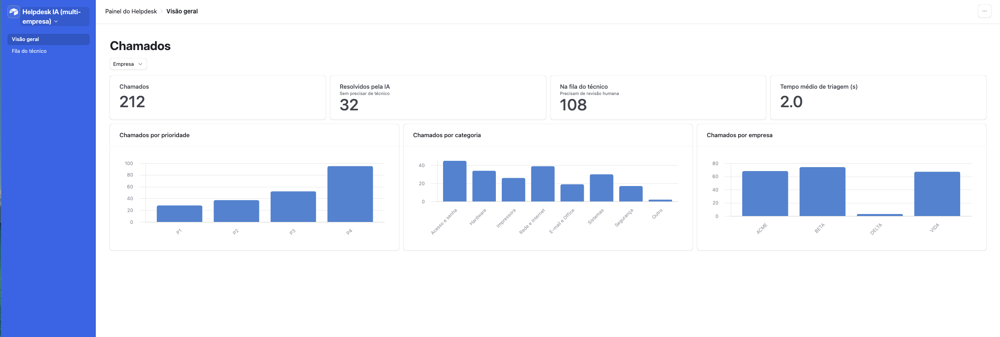
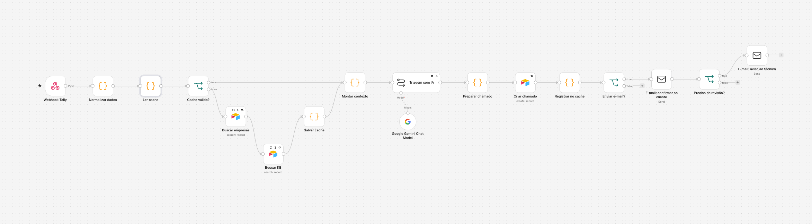
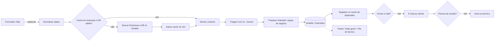
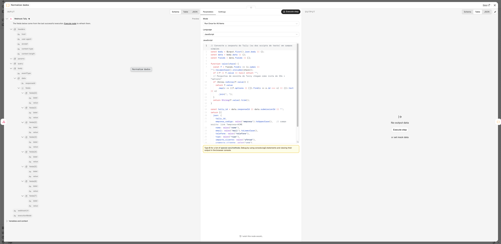
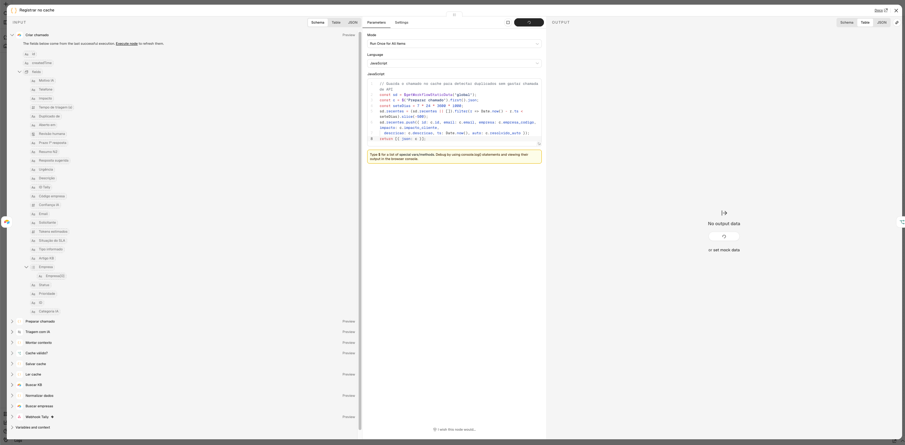
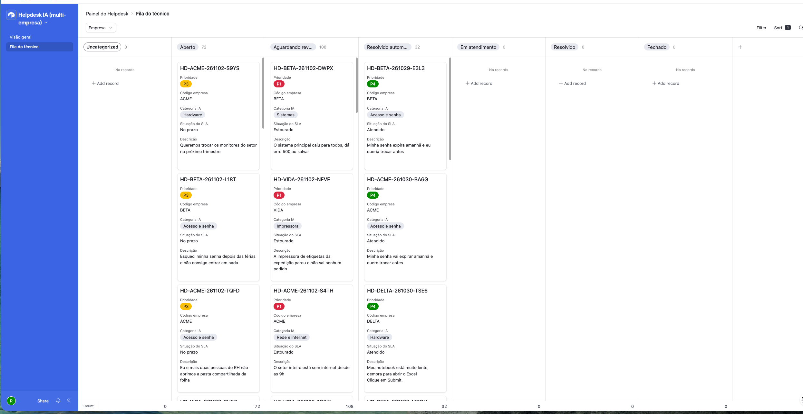

# Helpdesk com IA para várias empresas

Quando o computador de alguém dá problema no trabalho, essa pessoa abre um chamado e espera alguém do suporte responder. Muitas empresas terceirizam esse suporte: uma única equipe cuida da informática de vários clientes ao mesmo tempo.

O gargalo dessa equipe é a triagem. Alguém precisa ler cada pedido, entender o que é, decidir se é urgente, procurar a solução e avisar o cliente. Enquanto isso, um "esqueci minha senha" fica na mesma fila de um "o sistema caiu para a empresa inteira".

Este projeto automatiza essa primeira etapa. A pessoa preenche um formulário e, em menos de 2 segundos, o chamado já está classificado, com a urgência definida e encaminhado. Se for algo simples, como trocar a própria senha, a solução chega por e-mail na hora, sem esperar um técnico. Se cinco pessoas avisam que a internet caiu, o sistema entende que é um problema só e abre uma tarefa, não cinco. O técnico recebe apenas o que realmente precisa dele, já com um resumo pronto, e acompanha tudo num painel.

Cada empresa cliente tem as suas regras: prazos de atendimento diferentes, artigos de ajuda próprios e a escolha de aceitar ou não a resolução automática. Para atender uma empresa nova, basta cadastrá-la numa tabela.



## O que eu testei

Não quis parar numa demonstração com três exemplos. Simulei 200 chamados de 3 empresas fictícias (uma empresa de logística, um escritório de contabilidade e uma clínica) e montei um gabarito com a resposta certa de cada um, para medir quanto a IA acerta.

No primeiro teste, o sistema só reconheceu 44% dos chamados repetidos. Investiguei e achei a causa: vários chamados sendo processados ao mesmo tempo apagavam a memória uns dos outros. Coloquei os chamados em fila, rodei tudo de novo e o acerto subiu para 96%. De quebra, o tempo de análise caiu de 23,5 para 1,8 segundo.

| O que foi medido | Resultado |
|---|---|
| Chamados processados | 200 de 200, sem nenhum erro |
| Tempo médio de análise | 1,8 segundo |
| Urgência correta | 100% |
| Tipo de problema correto | 96% |
| Artigo de ajuda correto | 100% |
| Chamados repetidos agrupados | 96% (eram 44% antes da correção) |
| Problemas simples resolvidos sem técnico | todos os que podiam ser |
| Custo se fosse num plano pago | R$ 3,74 a cada mil chamados |

A IA não decide tudo sozinha. A urgência e os prazos seguem regras fixas usadas no mercado, e o sistema só aceita da IA respostas que existem de verdade. Na dúvida, o chamado vai para uma pessoa. Tudo roda em planos gratuitos.

Passei 15 anos gerenciando operações que funcionam 24 horas por dia, lidando com incidentes, equipes e fornecedores. Este projeto leva essa experiência para o suporte de TI.

---

## Como funciona por dentro

### Stack

| Camada | Ferramenta |
|---|---|
| Entrada | Formulário Tally (webhook), com campo oculto `?empresa=CÓDIGO` por cliente |
| Orquestração | n8n Community (self-hosted em Docker) |
| IA | Google Gemini `gemini-3.5-flash-lite` via nó LangChain do n8n (plano gratuito) |
| Banco e painel | Airtable (tabelas Empresas, KB e Chamados + Interface com dashboard e kanban) |
| Notificação | E-mail SMTP (confirmação ao cliente e aviso ao técnico) |
| Testes | Bash + curl (carga de 200 chamados) e Python (medição contra gabarito) |

### Arquitetura

O fluxo no n8n, com os 17 nós:



O mesmo fluxo, em diagrama:



### Como a triagem funciona

**1. Contexto por empresa (multi-tenant).** O formulário envia o código da empresa num campo oculto. O fluxo carrega só os dados daquela empresa: nome, segmento, SLA por prioridade, se aceita resolução automática e os artigos da base de conhecimento dela (mais os artigos comuns a todas).

O nó "Normalizar dados" converte a resposta do formulário em campos simples, incluindo o código da empresa:



**2. Candidatos a duplicado, sem gastar API.** O n8n guarda os chamados dos últimos 7 dias em *static data*. Entram como candidatos: chamados do **mesmo solicitante** (7 dias) ou **incidentes coletivos da mesma empresa** (24 h, quando o impacto não é "Só eu"). A IA recebe no máximo 10 candidatos e decide se o novo chamado é o mesmo problema.

O nó "Registrar no cache" guarda cada chamado na memória de 7 dias usada para achar duplicados:



**3. A IA responde em JSON estrito:** `categoria`, `artigo_kb`, `confianca`, `duplicado_de`, `revisar_prioridade`, `motivo`, `resumo_n2` (para o técnico) e `resposta_cliente` (rascunho).

**4. Regras determinísticas por cima da IA (guardrails):**
- **Prioridade pela matriz ITIL** impacto x urgência (P1 a P4), calculada por regra, não pela IA.
- **SLA** vem do contrato de cada empresa (sem empresa identificada, usa o mais rígido).
- **Validação da saída:** categoria fora da lista vira "Outro"; artigo ou ID de duplicado que não existe é descartado (evita alucinação).
- **Revisão humana** quando: a IA falhou, empresa não identificada, P1/P2, duplicado, confiança < 0,7, a IA viu risco diferente do informado, ou categoria Segurança.
- **Resolução automática** só quando: P4, sem revisão, artigo marcado como autoatendimento, confiança ≥ 0,8 e empresa que aceita.

**5. Economia de API.** Empresas e KB ficam em cache por 15 minutos (o Airtable free tem limite mensal de chamadas de API).

### Teste de escala (200 chamados)

O script [`testes/carga_200.sh`](testes/carga_200.sh) envia 200 chamados de 3 empresas fictícias (ACME, BETA e VIDA) a cada 5 s, cobrindo 15 modelos de problema, incidentes coletivos e repetições. O [`dados/gabarito_200.csv`](dados/gabarito_200.csv) diz a resposta certa de cada um, e o [`testes/medir_resultados.py`](testes/medir_resultados.py) compara o que foi gravado no Airtable com o gabarito.

| Métrica | Rodada 1 | Rodada 2 (com fila) |
|---|---|---|
| Chamados registrados / erros da IA | 200 / 0 | 200 / 0 |
| Prioridade correta | 100% | 100% |
| Categoria correta | 98% | 96% |
| Artigo da KB correto | 96% | 100% |
| Duplicados e incidentes coletivos agrupados | **31/70 (44%)** | **67/70 (96%)** |
| Resolução automática (dos que deveriam) | 29/29 | 29/29 |
| Tempo médio de triagem | 23,5 s | **1,8 s** |
| Tokens por chamado / custo se pago | ~1.020 / R$ 3,37 por mil | ~1.130 / R$ 3,74 por mil |

Arquivos completos em [`resultados/`](resultados/).

#### O bug de concorrência (e a correção)

Na rodada 1, só 44% dos duplicados foram agrupados. A causa: com os chamados chegando a cada 5 s e a IA levando alguns segundos, o n8n executava **várias instâncias do fluxo em paralelo**. Todas liam a lista de chamados recentes do *static data*, adicionavam o seu e gravavam de volta. **A última gravação apagava as outras** (condição de corrida, *lost update*), então o chamado seguinte não "via" os anteriores.

Correção: limitar a execução de produção a **uma por vez** (fila), com a variável `N8N_CONCURRENCY_PRODUCTION_LIMIT=1`. Resultado: duplicados de 44% para **96%**, e o tempo médio de triagem caiu de 23,5 s para **1,8 s**, porque as execuções pararam de disputar a API da IA ao mesmo tempo.

Observações da rodada 2, conferidas uma a uma:
- Os 19 chamados "marcados como duplicado sem estar no gabarito" são a **mesma pessoa mandando o mesmo texto** cerca de 2 h depois (o gerador repete frases a cada 120 chamados). São duplicados reais: **0 falsos positivos**.
- Os 8 erros de categoria são o mesmo caso: "acesso ao Power BI", que a IA classifica como Sistemas e o gabarito como Acesso e senha. É uma ambiguidade da própria regra.

Próximo passo para escalar além de uma fila: guardar os recentes num banco com escrita atômica (por exemplo Redis ou Postgres) e voltar a processar em paralelo.

### Painel (Airtable Interface)

| Visão geral | Fila do técnico |
|---|---|
|  |  |

- **Visão geral:** total de chamados, resolvidos pela IA, fila do técnico e tempo médio de triagem; gráficos por prioridade, categoria e empresa; filtro por empresa.
- **Fila do técnico:** kanban por status, ordenado e colorido por prioridade.

### Estrutura do repositório

```
workflow/   helpdesk_ia_workflow.json   fluxo do n8n (credenciais e IDs como placeholders)
dados/      kb_base_conhecimento.csv    base de conhecimento das 3 empresas
            gabarito_200.csv            resposta esperada de cada chamado do teste
testes/     carga_200.sh                teste de escala (200 chamados, sem enviar e-mail)
            demo_9_chamados.sh          demonstração com 9 chamados e e-mails reais
            medir_resultados.py         mede acerto, tempo, duplicados e custo
resultados/ métricas e CSVs das rodadas 1 e 2
docs/prints/ prints do painel
```

### Como rodar

1. **n8n no Docker** (com a fila que corrige os duplicados):
   ```bash
   docker run -d --name n8n --restart unless-stopped -p 5678:5678 \
     -e GENERIC_TIMEZONE=America/Sao_Paulo -e TZ=America/Sao_Paulo \
     -e N8N_CONCURRENCY_PRODUCTION_LIMIT=1 \
     -v n8n_data:/home/node/.n8n docker.n8n.io/n8nio/n8n
   ```
2. **Airtable:** crie uma base com três tabelas:
   - **Empresas:** Código, Nome, Segmento, Ativa, SLA P1 (min), SLA P2 (min), SLA P3 (min), SLA P4 (min), Resolução automática.
   - **KB:** importe [`dados/kb_base_conhecimento.csv`](dados/kb_base_conhecimento.csv) (ID, Título, Empresa, Categoria, Sintomas, Solução, Autoatendimento).
   - **Chamados:** ID, ID Tally, Empresa (link), Código empresa, Descrição, Categoria IA, Artigo KB, Prioridade, Status, Duplicado de, Resolvido automaticamente, Revisão humana, Motivo IA, Tempo de triagem, Tokens, Aberto em, Situação do SLA.
3. **n8n:** importe [`workflow/helpdesk_ia_workflow.json`](workflow/helpdesk_ia_workflow.json), crie as credenciais (token do Airtable, chave da Gemini API, conta SMTP) e troque os placeholders `SUA_BASE_AIRTABLE`, `TABELA_EMPRESAS`, `TABELA_KB`, `TABELA_CHAMADOS` e `SEU_EMAIL` pelos seus. Publique o workflow.
4. **Formulário:** aponte o webhook do Tally para `/webhook/helpdesk-tally` (com um túnel, se o n8n estiver local) e use um link por empresa com `?empresa=ACME`.
5. **Teste de escala:** `bash testes/carga_200.sh 1 200 5`, exporte a tabela Chamados para `chamados.csv` e rode `python3 testes/medir_resultados.py chamados.csv dados/gabarito_200.csv`.

### Segurança e privacidade

- Nenhuma chave, senha ou token está neste repositório: as credenciais ficam só no n8n e aparecem no JSON como `SUBSTITUA`.
- As empresas, pessoas e e-mails do teste são fictícios (domínios `.example`).
- Chamados de teste (IDs começando com `carga`) nunca disparam e-mail.

---

**Autor:** Rafael Figueiredo · [github.com/Rafaelmcf](https://github.com/Rafaelmcf)

Projeto de portfólio na transição de 15 anos de gestão de operações 24x7 para Service Desk, NOC e Cloud. Formado no AWS re/Start (Escola da Nuvem), AWS Certified Cloud Practitioner.
